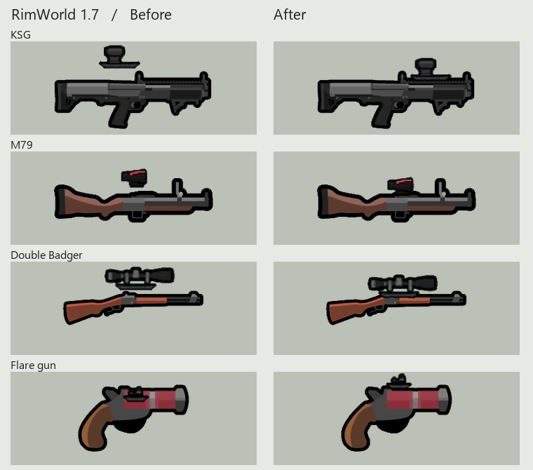

# Phase 01: Implement and verify the ten weapon definitions

## Goal

- Enable shared workbench parts for all ten targets.

## Scope

- RimWorld 1.7, MW2, CE core and the optional CE Attachments add-on.

## Non-goals

- Later roadmap weapons and custom receiver artwork.

## Affected files

- Common/Patches/Weapons/CECore, CEAttachments/Patches/Weapons, the 1.7 integration assembly and package metadata, and installation guidance in README.md.

## Implementation steps

- Inspect native definitions and textures, select compatible mounts, apply conditional XML, and test both loadouts.

## Acceptance criteria

- Preserve the native CE functions and verify the workbench and save/load checks in issue #1.

## Validation commands

- Build the Release solution with the reference paths in README.md. Run tools/package_mod.py, then test the ZIP with python -m zipfile -t. Inspect the game startup logs and verify the two loadouts described below.

## Manual smoke tests

- Fit and remove a part on a CE core weapon. Exercise both KSG magazines, the disposable launcher, and flare behavior. Save and reload a customized weapon.

## Rollback risks

- Removing support from a save may discard the part configuration. Use disposable test saves.

## Progress

- Identified the three CE core definitions at CE commit ecf1f16dc9509073fe11952f4651b55a68fce0c9. The corresponding definitions match the prior 1.6 inventory. Prepared an isolated copy of RimWorld 1.7.5014 for testing.

## Decision log

- Target 1.7 using the CE development build. Use the game’s native load-folder fallback for CE Attachments, which declares support through 1.6. Package the rebuilt integration assembly with the upstream Alpha0.3.3 content and the fork’s XML.

## Outcomes / Retrospective

The isolated test environment uses RimWorld 1.7.5014 rev1195, MW2 assembly 1.7.0.0, Harmony assembly 3.0.0.0, CE 17.0 at ecf1f16dc9509073fe11952f4651b55a68fce0c9, and CE Attachments at 8bcabf0cb58e6f1a65cc034cfa7046697255175a.

The test pawn uses the fueled gunsmith workbench to customize a loaded KSG. Opening the workbench returns three slugs and five beanbag rounds. After the apply job, the pawn reloads both tubes, selects the secondary tube, saves the game, and reloads it. The checks compare both ammo IDs, counts, the selected tube and verb, and the installed part. Other checks exercise part attachment and removal, the remaining secondary barrels, the grenade projectile, the disposable launcher's consumption after firing, and the flare's live map effect.

With the tested CE revision, CE logs a failed XPath for SentienceCatalyst in its own Items_General.xml. The same error occurs with this patch disabled.

On 2026-11-25 the final ZIP passed 37 of 37 runtime checks with CE core and 147 of 147 with CE Attachments enabled, on separate game maps and save profiles. All ten target weapon types retained their installed parts in a full game save/load round trip. Static checks confirmed that the patches preserve native CE verbs, components, stats, and sprite size. A sprite composition check informed mount placement. These gameplay results were recorded before the attachment alignment revision below.

## Attachment alignment revision

The first preview omitted optics that use intermediate adapters. The released coordinates left visible gaps on eight M79 sights, eight KSG sights and ten Double Badger sights. The flare gun had the opposite problem: its micro sight was drawn inside the barrel.

The revised XML seats those sights on the weapon sprites and raises the buried pistol optics. The updated preview tool resolves inherited attachment mounts and intermediate adapters. For each of 106 single-part combinations, its texture names, draw order, offsets and scales matched the draw requests issued by MW2 in RimWorld 1.7.5014. We captured the resulting game textures for all ten weapons. All 26 previously separated sight variants now meet the weapon silhouette. The final run captured 149 images, including unmodified weapons, empty slots and fully equipped configurations.

The revised installation ZIP has SHA-256 e63f83176003d88820d0b0f017016e8552ea7d53be1d4d5306076a66704afd06.